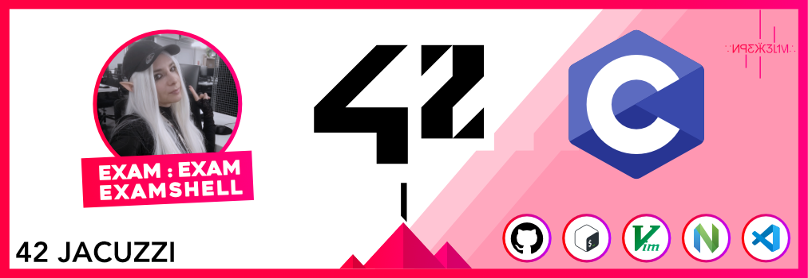

# 42 NEXT ADVANCED CONFIG 
Here, we see how to create it easily and both connection with your personal git (github). 
the dual connection is not necessary but its fun to do this for improve your skills and create memories.

## CREATE A SSH-KEY 42 EXTERNAL SESSION [SAFE]
42 profile authorize 3 ssh keys connection.
actually just one is necessary but for secure reason we create a ssh key for external machine from 42

## ADD GITHUB 42 LEARNER AS MIRROR 
To see the remote connexion reposotory
```bash
git remote -v
```
Now 

HTTPS
```https
git remote add [github] https://github.com/[USER]/[repo].git
```
SSH
```
git remote add [github] https://github.com/[USER]/[repo].git
```

note master:main is a trick to sync the branch vogsphere/master to github/main. if you want to clean your repo, choice a vintage master name.
`git push origin master && git push github master:main`

### ADD .bashrc or .zshrc ALIAS


## .gitconfig to build a perfect ci/cd 42/personal repo
underconstruction for pisciners, retryers and students

## .gitignore & .gitignore\_global

Create a file `.gitignore_global` into home folder `~/.gitignore_global`
 
```
*~
.a
.env
.out
.swp
.swo
.swn
```
if you works on a mac add `.DS_Store`


