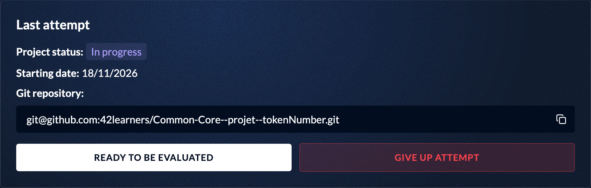

# 42 NEXT ADVANCED CONFIG 
Here, we see how to create it easily and both connection with your personal git (github). 
the dual connection is not necessary but its fun to do this for improve your skills and create memories.

## CREATE GITCONFIG


## CREATE A SSH-KEY 42 EXTERNAL SESSION [SAFE]
42Learner profile authorize ssh keys connection.
actually just one is necessary but for secure reason we create a ssh key for external machine from 42

## ADD GITHUB 42 LEARNER AS MIRROR 
To see the remote connexion repositories. in this configuration you work of your personal github and clone the 42 repository with an upstream link. 

You can do it on your personal notebook and 42 session 



```bash
git remote -v
```
Normally you see you personal repo   
*origin  git@github.com:login/project.git (fetch)  
origin  git@github.com:login/project.git (push)*

if origin does not exist on my personal repository
```
git remote add origin git@github.com:[login]/[project].git
```
Add your 42 repository 
```
git remote add upstream git@github.com:42learners/[project42uri].git
```
**If you fail your review**, 42 build a new repository. You have to update it 
```
git remote set-url upstream git@github.com:42learners/[newproject42uri].git
```
you can verified with `git remote -v` if the repo are corretly added.

## COMMANDS TO PULL AND PUSH 
the command to push and pull 
`git push origin master && git push github master:main`

### ADD .bashrc or .zshrc ALIAS
for simplicity add the alias below in your bash zsh configuration 


```
# GIT -------------------------------------------------------#
alias push42="git push upstream main"
alias pushome="git push origin main"
alias pushall="git push origin main && git push upstream main"

alias pull42="git pull upstream main"
alias pullhome="git pull origin main"
alias pullall="git pull origin main && git pull upstream main"
# GIT -------------------------------------------------------#
```


## .gitconfig to build a perfect ci/cd 42/personal repo
underconstruction for pisciners, retryers and students

## .gitignore & .gitignore\_global

Create a file `.gitignore_global` into home folder `~/.gitignore_global`
 
```
*~
.a
.env
.out
.swp
.swo
.swn
```
if you works on a mac add `.DS_Store`


